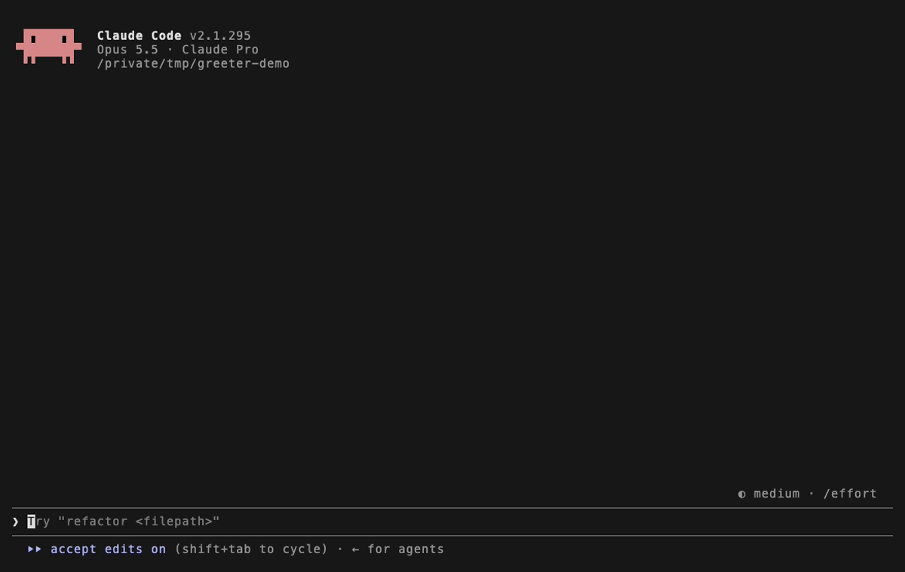

# ks-ai-stack

Claude Code mods and agent skills by imksc.

## Install

Add the marketplace once:

```bash
claude plugin marketplace add im-ksc/ks-ai-stack
```

Then install the mods you want with the line in each section below, and restart Claude Code.

## Mods

### replay-theater

Step through the file edits Claude made in the last turn, one diff at a time. After a turn with edits, a hint above the prompt counts them. Run `/replay` or press the Replay button to open the pane.



```bash
claude plugin install replay-theater@ks-ai-stack
```

More in the [replay-theater README](mod/replay-theater/README.md).

### hud

A three-line band above the prompt. It shows the git branch and todo progress, context used, the session's cost and tokens, and the 5-hour and weekly usage limits. Run `/hud` to hide or show it.


```bash
claude plugin install hud@ks-ai-stack
```

More in the [hud README](mod/hud/README.md).

## Skills

[`.agents/skills`](.agents/skills) holds the agent skills I use with Claude Code, Codex and Gemini CLI. Sessions opened on this repo load them automatically. The [skills table](.agents/skills/README.md) lists each one with its source. To install them globally:

```bash
npx skills add im-ksc/ks-ai-stack -g
```

Run `npx skills update -g` to pull later changes from `main`.

## License

replay-theater is Apache-2.0, copied from [anthropics/claude-code-playground](https://github.com/anthropics/claude-code-playground). hud has no license yet. Each skill copied from another repo keeps that repo's license, listed in the [skills table](.agents/skills/README.md).

## Working on this repo

To pull the latest mods and skills from `main`:

```bash
pnpm sync
```

This runs `git pull --ff-only` in `~/.claude/mods/ks-ai-stack` (cloning it first if it's missing), then `npx skills update -g`. Use `pnpm sync:mods` or `pnpm sync:skills` for one half. It needs only Node and git, so `npm run sync` or `node scripts/sync.mjs` work too, on macOS, Linux and Windows. Restart Claude Code afterwards.
