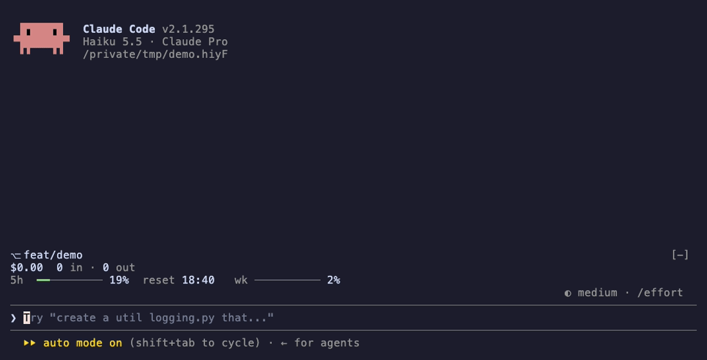

# HUD

A Claude Code mod that draws a band of up to six lines above the prompt. The first line holds the git branch, a one-sentence verdict on the usage limits, the session's cost and tokens, and two buttons. Under it, the 5-hour and weekly limits sit on the left and the context on the right.

```text
⎇ feat/hud* │ Cruising. Plenty left for Wednesday. │ $0.42 · 1.2M in · 38k out  [ Compact ] [ ▾ ]
5 Hour ━━━━━━━━━━━━━━━━━━━━━━━━━━━━━━━━━━━┃━━━━━━───  81%   ████████████▓▓▓▒▒░░░░░░░░░░░░░░░░░░░░░░░░░░░░░░░░░░
  On pace for ~87% · resets in 23m                         Context 24% to compact                   120k left of 160k
Weekly ━━━━━━━━┃━━━━──────────────────────────────────  20%   Messages                                                190k
  On pace for ~36% · resets in 2d 20h                      Tools                                                    36k
                                                           Other                                                    18k
```

Collapsed, it's one line spread across the band, and each bar becomes a ring (a circle glyph in a terminal):

```text
   ⎇ feat/hud*   │   ◕ 5 Hour 81% ↻ 14:00   │   ◔ Week 20% ↻ Wed 09:00   │   ◔ Context 30%   │   $0.42   [ Compact ] [ ▸ ]
```

## What this shows

| Part | What it reads |
| --- | --- |
| `⎇ feat/hud*` | `git branch --show-current`, and `*` when `git status --porcelain` lists changes. Read at session start and after every Bash call. Hidden outside a git repository and on a detached HEAD. |
| Verdict | Whether the 5-hour and weekly limits last until they reset, at the rate they've been used so far. Green: `Cruising. Plenty left for Wednesday.` Yellow, or red from 90% used: `Easy, tiger. 5-hour runs dry 14:50, 30m early.` Red: `Weekly's tapped out. Back Wednesday 09:00.` Cut short with `…` when the line is too narrow. |
| `$0.42 · 1.2M in · 38k out` | The cost `/cost` reports. On a Pro or Max subscription this is what the same tokens would cost at API prices, not a charge. Input counts uncached, cache-write and cache-read tokens. Subagents' tokens are included. |
| `5 Hour ━━━┃━── 81%` | How much of the 5-hour window is used. The `┃` marks how much of the window has passed, so a bar that fills past it is ahead of pace. The line under it projects the use at the reset and counts down to it. The tick and projection appear once 10% of the window has passed. Until then the line says `Too early to project`. |
| `Weekly ━━━┃━── 20%` | The same for the weekly window. |
| `████▓▒░░ Context 24% to compact` | Context used, measured against the point where auto-compact runs. The bar is split into messages, tools and everything else, in the colours `/context` uses, with each part's tokens listed below it. With auto-compact off, it's measured against the model's context window and reads `used`. |
| `↻ 14:00` | Collapsed only: when each limit resets. The time alone for today, the day too for later. |

The limit bars and percentages are green below 70% used, yellow from 70%, and red from 90%. The rings on the collapsed line follow the same colours. A part with nothing to show is left out, and countdowns redraw every minute.

In the desktop app, the bars are drawn as solid rounded bars that fill their column, and the limits always sit beside the context. On a terminal narrower than 80 columns, the context goes under the limits, and the projections and the context breakdown are dropped.

| Control | What it does |
| --- | --- |
| `Compact` (`c`) | Runs `/compact`. Pressed during a turn, it runs once the turn ends. A failure shows the reason Claude Code gives. |
| `▾` / `▸` (`h`) | Collapses the band to one line, or expands it. The choice is kept across sessions. The desktop app draws a larger triangle without button shading, with the click area centred on it. |
| `/hud` | Hides or shows the whole band. The choice is kept across sessions. |

The hotkeys work in a terminal while the band has the focus: click it, or press ctrl+x tab. The desktop app shows plain buttons without them.

The patterns it demonstrates:

- An `AbovePrompt` band drawn from `$.state` values, so it redraws by itself when a value changes, laid out to the band's `bodyColumns`.
- Buttons in a band, with hotkeys, and a `$.clock.every` timer that redraws the countdowns.
- Reading the engine's own figures from `session.measure` and `$.session.usage()`, instead of computing cost or context.
- Watching tool results in `tool.call` after `next(e)`, without changing them.
- A slash command whose setting is kept in `$.store`.

## Demo

The recording shows version 0.2, before the redesign. Claude works through a four-item todo list in a new repo on `feat/demo`. The branch gets a `*` once the first file exists, the todo bar fills with the current item beside it, and the context, cost and token figures fill in when the turn ends. The recording is scripted: run `vhs mod/hud/demo/hud.tape` from the repo root in a plain terminal to make it again.



## How it was built

- **Model:** built with Claude in Claude Code. The mod itself doesn't call a model.
- **Prompt(s):**

  > I want a mod that will show a band above prompt input.
  >
  > 1. Show progress bar of todo
  > 2. Show context bar before auto-compact/limit
  > 3. Show branch it's working on
  > 4. Show rough estimation of cost incurred based on token input/output and model used?
  > 5. Show 5hr and weekly usage remaining

- **Transcript:** not shared.
- **Iterations:**
  - The request asked for a cost estimate from tokens and a price table. The engine already reports the session's cost per model, so the band shows that figure and the token counts beside it.
  - The layout, colours, the dirty mark and the `/hud` toggle were settled in an interview before building.
  - Tested with `claude plugin test` only. It hasn't been tried in a live terminal yet.
  - 0.2.0, after use in a live terminal: the band was hard to scan and wrapped on narrow terminals. It moved to three lines, with dim labels, 10-cell bars, a token fraction for context, and the limits shown as used rather than left.
  - 0.2.1: the replay-theater hint replaced the band after each turn. Both mods now draw the band beneath them under their own rows.
  - 0.3.0: a redesign settled in an interview, with a screenshot of another usage panel as the reference. The limits gained a pace tick, a projection and a verdict. The context bar is split by category. Compact and collapse buttons were added, and the todo bar moved to the collapsed line.
  - 0.3.1, after use in the desktop app: the band stacked at a normal window width, the buttons showed hotkey chips, and every Compact failure read as "between turns". The desktop now draws SVG bars in two columns with plain buttons, terminals split from 80 columns, and Compact shows the real reason it failed when no turn is running.
  - 0.3.2: the two columns sat right under the headline, the usage column was shorter than the context column, and the collapse button was shaded. The body now has a gap above it, the usage rows spread to the context column's height, and the desktop's collapse control is a bigger triangle with no shading.
  - 0.3.3: Compact failed in the desktop app, which can't compact from a mod directly, so the button now runs `/compact` and waits for a running turn. The verdicts are shorter, the collapsed line has dividers, each limit's bar stays with its reset line, and the desktop's collapse click area covers the whole triangle.
  - 0.3.5: a limit under 10% into its window now says `Too early to project` rather than leaving out its projection. The `..` beside the desktop collapse triangle, the button cutting its blank label short, is now transparent.
  - 0.3.4: the collapse click area still sat left of the triangle, because spaces in the desktop's font are narrower than cells. It's now centred on the triangle. The collapsed line, modelled on a screenshot of another usage line, spreads across the band with full labels, each limit's reset time and, in the desktop app, SVG rings. The todo count was dropped from it.

## Run it

**Requirements:**

- Claude Code 2.1.296 or later. The mod was built and tested against 2.1.296.
- `git` on the `PATH` for the branch part.
- The usage limits appear only on a Pro or Max subscription, after the session's first response.

No environment variables or configuration.

**Steps:**

1. Clone this repository:

   ```bash
   git clone https://github.com/im-ksc/ks-ai-stack.git
   cd ks-ai-stack
   ```

2. Check the plugin and run its tests:

   ```bash
   claude plugin validate ./mod/hud
   claude plugin test ./mod/hud
   ```

3. Try it for one session:

   ```bash
   claude --plugin-dir ./mod/hud
   ```

   Or install it, with the other mods here, from the marketplace at the repository root (see the [root README](../../README.md)):

   ```bash
   claude plugin marketplace add ./
   claude plugin install hud@ks-ai-stack --scope user
   ```

4. Send Claude a message. The context, cost and limits fill in when the response ends.
5. Click the band, or press ctrl+x tab, then press `h` to collapse it and `c` to compact.
6. Type `/hud` to hide the band, and again to show it.

## Notes / limitations

- The context, cost and usage parts appear after the session's first response. Before that the engine has no reading.
- The verdict and the projections assume use carries on at the average rate since the window started.
- The context breakdown groups `/context`'s rows by name: `Messages`, rows with "tool" in the name, and the rest.
- The context percentage uses the engine's local estimate of the auto-compact point, which sends no API request.
- Token counts are kept for the session. `/clear` empties them. After `--resume` the token counts start from zero while the cost doesn't, because the cost comes from the engine's ledger.
- The branch isn't refreshed when you change branches outside Claude Code. It updates after Claude's next Bash call or the next session.
- The band above the prompt is shared. Another mod's band, such as the replay-theater hint, shows under the HUD. Which band sits on top depends on the order Claude Code runs the mods in.
- A gateway's `spend_limit` window isn't shown.

## Dependencies

| Name | Version | License (SPDX) | Source |
| --- | --- | --- | --- |
| None | | | |

## Third-party notices

None.
